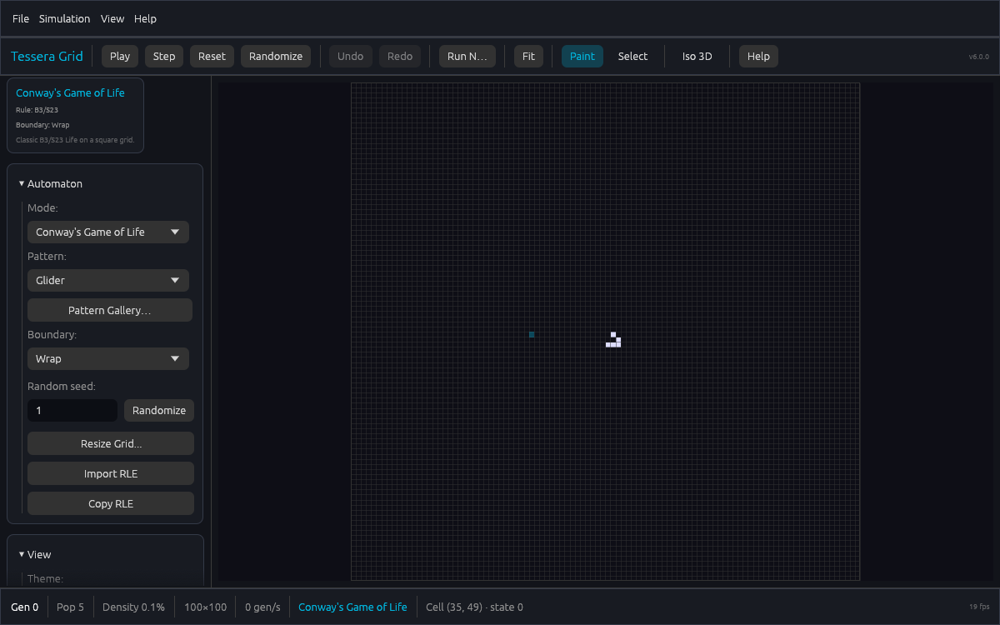
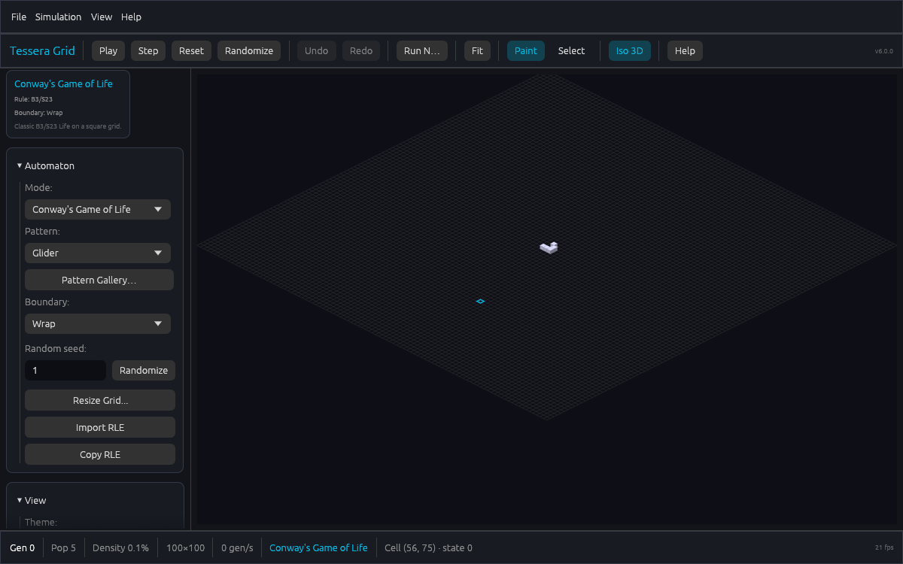
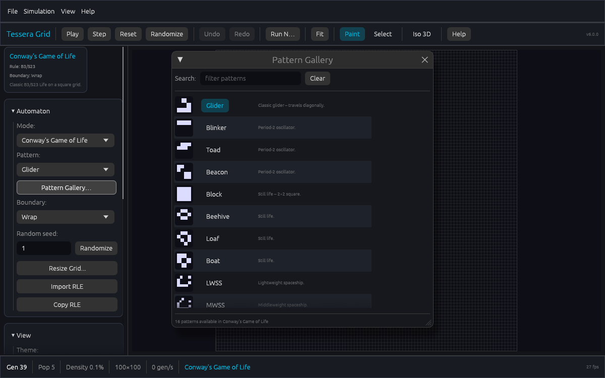
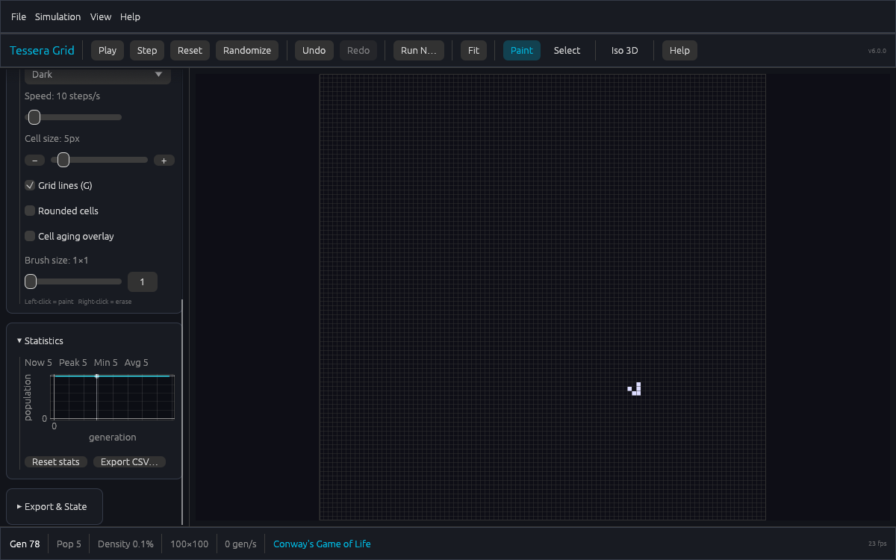
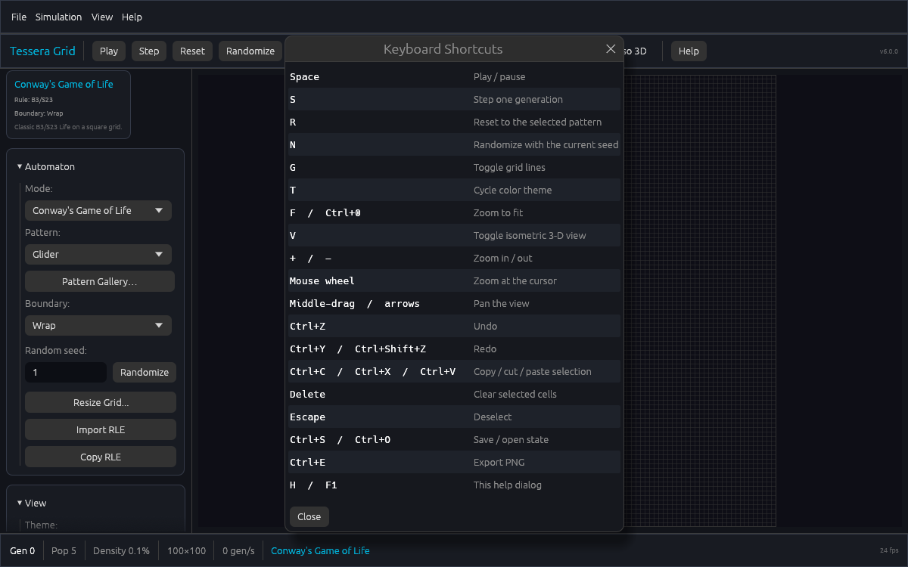
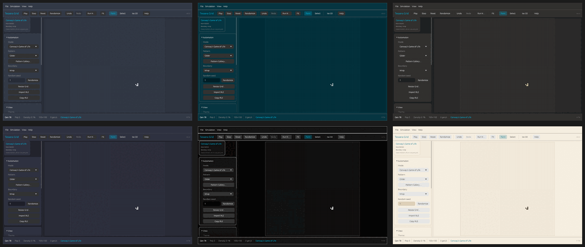

# Tessera Grid

[](https://github.com/James-HoneyBadger/LifeGrid/actions/workflows/ci.yml)
[](https://github.com/James-HoneyBadger/LifeGrid/actions/workflows/release.yml)
[](LICENSE)

A fast, native cellular-automaton simulator built with **Rust** and **egui**.

Tessera Grid runs ten classic and custom automata in one interactive window — with a
pattern gallery, seeded random soups, custom B/S rules, an isometric 3-D view,
RLE import/export, PNG/GIF capture, a live population chart, and a headless CLI
for scripted runs.

---

## Features

- **10 automata** — Conway, High Life, Hexagonal Life, Immigration, Rainbow,
  Langton's Ant, Wireworld, Brian's Brain, Generations, and any custom B/S rule.
- **Direct manipulation** — paint with a 1–8 cell brush, interpolated strokes,
  right-click erase, region select/copy/cut/paste, wheel zoom, middle-drag pan.
- **Pattern gallery** — searchable list with thumbnails and descriptions for
  every Conway pattern, plus `Empty` and seeded `Randomize` in every mode.
- **Custom rules** — type strings such as `B36/S23` or `B2/S`; the rule is
  applied on every keystroke.
- **Boundary modes** — wrap (toroidal), fixed (dead edges), reflect (mirror).
  Modes that ignore boundaries show the control disabled.
- **Isometric 3-D view** — height-mapped blocks with adjustable block height.
- **Aging overlay** — colour long-lived cells by age.
- **RLE** — import from and copy to the clipboard; exports carry the correct
  per-mode rule header and multi-state letters.
- **Export** — PNG snapshot or animated GIF (frames buffered to a 256 MB budget).
- **Undo / redo** — 100 snapshots covering every edit, including generation.
- **Live statistics** — population chart with axes, peak/min/average, CSV export.
- **Session state** — save/load `.tessera` JSON files (legacy `.lifegrid` files still load); UI settings persist.
- **Headless CLI** — drive the same engine from scripts and CI.
- **8 color themes** — Dark, Light, Nord, Solarized Dark, Gruvbox, Dracula,
  High Contrast, and Paper; switch instantly with `T`.
- **Cross-platform** — Linux, macOS, and Windows.

---

## Screenshots

| Main window | Isometric 3-D |
|-------------|---------------|
|  |  |

| Pattern gallery | Statistics |
|-----------------|------------|
|  |  |





*Nord, Solarized Dark, Gruvbox, Dracula, High Contrast and Paper.*

---

## Prerequisites

- **Rust 1.95 or newer** (required by egui 0.36+). `rustup` installs it via
  [rust-toolchain.toml](rust-toolchain.toml).
- A C linker (`gcc` or `clang`).
- A display server (X11 or Wayland) **only for the GUI**; the CLI is headless.
- Linux build libraries:

  ```bash
  sudo apt-get install libxkbcommon-dev libwayland-dev libx11-dev \
      libudev-dev libgl1-mesa-dev pkg-config build-essential
  ```

  macOS needs Xcode Command Line Tools; Windows needs the MSVC build tools.

---

## Quick Start

```bash
git clone https://github.com/James-HoneyBadger/LifeGrid.git
cd LifeGrid
./run-simulation.sh
```

Extra arguments are forwarded to the binary, so the same script runs headless
jobs:

```bash
./run-simulation.sh --steps 250 --png growth.png --stats
```

Or work directly in the crate:

```bash
cd tessera-grid-rs
cargo run --release
cargo build --release && ./target/release/tessera
```

---

## Headless CLI

The binary is `tessera`. Any run with steps, exports, or `--headless` skips the
GUI entirely — useful for servers, CI, and reproducible experiments.

| Flag | Description |
|------|-------------|
| `--headless` | Never open a window |
| `--mode <MODE>` | Automaton mode (see `--list-modes`) |
| `--rule <B/S>` | Custom rule, e.g. `B36/S23`; implies Custom Rules |
| `--pattern <NAME>` | Starting pattern (defaults to the mode's first) |
| `--width`, `--height` | Grid size in cells |
| `--boundary <wrap\|fixed\|reflect>` | Edge behaviour |
| `--steps <N>` | Generations to simulate |
| `--randomize` | Fill with a random soup |
| `--seed <N>` | Seed for `--randomize` (implies it) |
| `--png <PATH>` | Write a PNG snapshot |
| `--gif <PATH>` | Record frames and write a GIF |
| `--gif-fps <N>` | GIF frame rate (default 10) |
| `--cell-size <N>` | Pixels per cell for PNG/GIF (default 4) |
| `--rle <PATH>` | Write the final grid as RLE |
| `--stats` | Print final statistics |
| `--list-modes` | List modes and exit |

Examples:

```bash
# Reproducible High Life run with PNG + GIF + RLE output
cargo run --release -- --rule B36/S23 --randomize --seed 42 \
    --steps 300 --png highlife.png --gif highlife.gif --rle highlife.rle

# Conway glider gun captured as a GIF
cargo run --release -- --pattern "Glider Gun" --steps 120 --gif gun.gif

# Machine-readable summary for scripts
cargo run --release -- --steps 100 --stats
```

---

## Usage

### Mouse

| Action | Input |
|--------|-------|
| Paint | Left-click / drag (respects brush size and paint state) |
| Erase | Right-click / drag |
| Zoom | Mouse wheel (centred on the cursor) |
| Pan | Middle-click drag, or arrow keys |
| Select a region | Select tool, then left-drag |
| Clear selection | Right-click (Select tool) |

### Keyboard

| Action | Shortcut |
|--------|----------|
| Play / pause | `Space` |
| Step one generation | `S` |
| Reset to selected pattern | `R` |
| Randomize (current seed) | `N` |
| Toggle grid lines | `G` |
| Cycle color theme | `T` |
| Zoom to fit | `F` or `Ctrl+0` |
| Toggle isometric 3-D | `V` |
| Zoom in / out | `+` / `-` |
| Undo | `Ctrl+Z` |
| Redo | `Ctrl+Y` or `Ctrl+Shift+Z` |
| Copy / cut / paste selection | `Ctrl+C` / `Ctrl+X` / `Ctrl+V` |
| Clear selected cells | `Delete` |
| Deselect | `Escape` |
| Save / open state | `Ctrl+S` / `Ctrl+O` |
| Export PNG | `Ctrl+E` |
| Shortcut reference | `H` or `F1` |

### Custom rules

Choose **Custom Rules** and type B/S notation, for example:

- `B36/S23` — High Life
- `B2/S` — Seeds
- `B3/S23` — Conway's Game of Life

### Saving and exporting

- **State files** (`.tessera`) are JSON containing the mode, generation, size,
  and cell buffer; they load across versions, and legacy `.lifegrid` files can
  still be opened.
- **RLE** uses standard Golly/LifeWiki syntax and carries the active rule in the
  header (`B36/S23`, `B2/S34H`, `WireWorld`, …).
- **GIF** recording keeps the newest frames within a 256 MB budget so long runs
  cannot exhaust memory.
- **Configuration** is stored at:
  - Linux: `$XDG_CONFIG_HOME/tessera-grid/` or `~/.config/tessera-grid/`
  - macOS: `~/Library/Application Support/tessera-grid/`
  - Windows: `%APPDATA%\tessera-grid\`
  - Override the directory with `TESSERA_CONFIG_DIR` (`LIFEGRID_CONFIG_DIR` is
    still honoured). An existing LifeGrid config is imported automatically.
  - The active theme, panel width, view mode, and brush size are saved here.

---

## Supported Automata

| Mode | Rule | Boundary control |
|------|------|------------------|
| Conway's Game of Life | `B3/S23` | wrap / fixed / reflect |
| High Life | `B36/S23` | wrap / fixed / reflect |
| Hexagonal Life | `B2/S34H` (odd-r hex) | fixed (wraps) |
| Immigration Game | two-colour `B3/S23` | wrap / fixed / reflect |
| Rainbow Game | six-colour cyclic Life | wrap / fixed / reflect |
| Langton's Ant | `LangtonsAnt` | fixed (wraps) |
| Wireworld | `WireWorld` | wrap / fixed / reflect |
| Brian's Brain | `Brian'sBrain` | wrap / fixed / reflect |
| Generations | `B3/S23/C8` | wrap / fixed / reflect |
| Custom Rules | any `B…/S…` | wrap / fixed / reflect |

---

## Project Structure

```text
LifeGrid/                 # repository name
├── tessera-grid-rs/       # crate: tessera-grid, binary: tessera
│   ├── Cargo.toml
│   ├── src/
│   │   ├── main.rs          # CLI dispatch + GUI launch
│   │   ├── cli.rs           # headless command line
│   │   ├── app/             # egui layer (no engine logic)
│   │   │   ├── mod.rs       # app state, helpers, eframe::App
│   │   │   ├── canvas.rs    # 2-D and isometric rendering/painting
│   │   │   ├── panels.rs    # sidebar controls
│   │   │   ├── toolbar.rs   # menu bar and toolbar
│   │   │   ├── dialogs.rs   # help, gallery, run-n, resize, about
│   │   │   ├── statusbar.rs
│   │   │   └── theme.rs
│   │   ├── sim.rs           # headless simulation controller
│   │   ├── rle.rs           # RLE parser/encoder
│   │   ├── patterns.rs      # built-in Conway patterns
│   │   ├── export.rs        # PNG and GIF rendering
│   │   ├── automata/        # 10 automata behind one trait + tests
│   │   └── core/            # grid, boundary, undo, config
│   └── tests/headless.rs    # end-to-end CLI tests
├── .github/workflows/       # CI and release pipelines
├── run-simulation.sh
├── CHANGELOG.md
├── CONTRIBUTING.md
└── CODE_OF_CONDUCT.md
```

---

## Development

```bash
cd tessera-grid-rs
cargo fmt --all --check
cargo clippy --all-targets -- -D warnings
cargo test --all-targets
cargo build --release
```

Unit tests live next to the code (`src/automata/tests.rs`, `src/sim.rs`,
`src/rle.rs`, `src/core/undo.rs`, `src/core/config.rs`), while
`tests/headless.rs` runs the real binary end to end.

See [CONTRIBUTING.md](CONTRIBUTING.md) for the full workflow.

---

## Roadmap

- [ ] GPU-accelerated grid stepping
- [ ] Runtime plugin loading for custom automata
- [ ] In-app pattern editor and RLE multistate authoring
- [ ] Timeline scrubber over recorded history
- [ ] MP4/WebM export

---

## Contributing

See [CONTRIBUTING.md](CONTRIBUTING.md) and [CODE_OF_CONDUCT.md](CODE_OF_CONDUCT.md).

## License

MIT — see [LICENSE](LICENSE).
