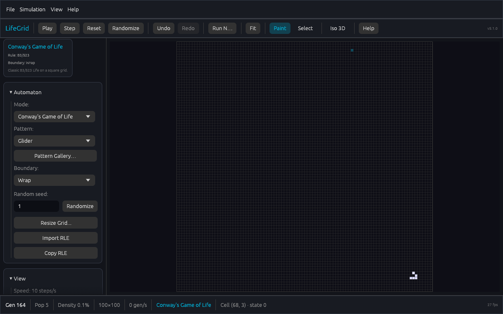
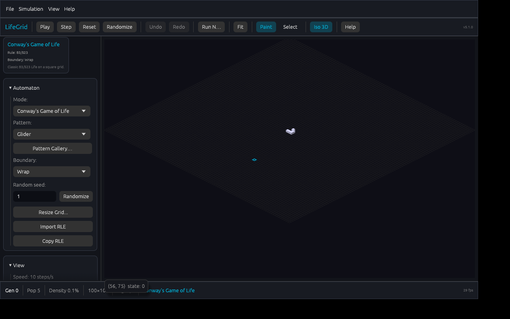
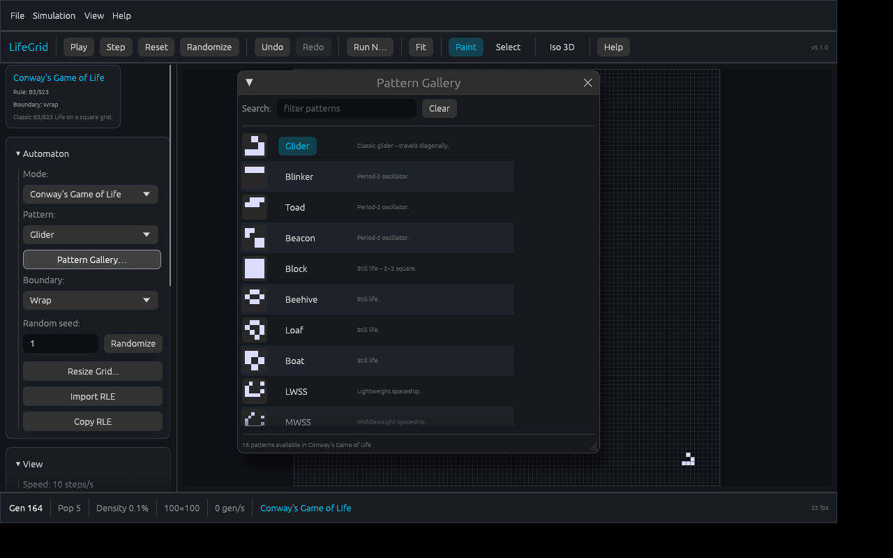
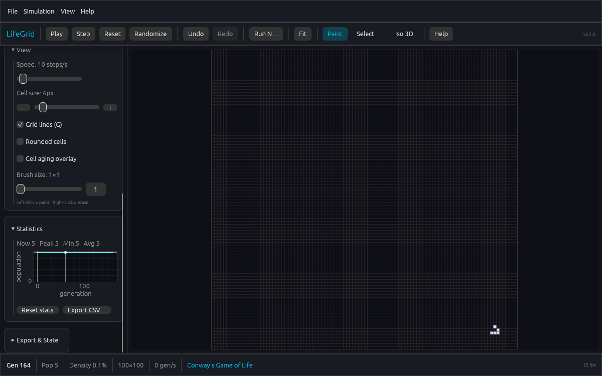
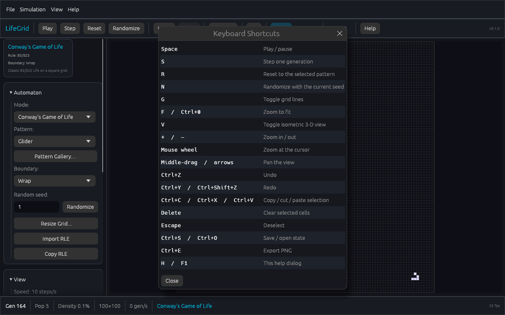
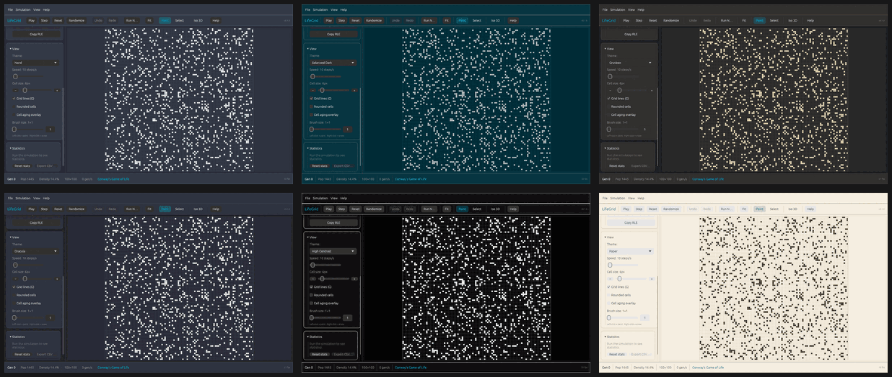

# Tessera Grid

[](https://github.com/James-HoneyBadger/TesseraGrid/actions/workflows/ci.yml)
[](https://github.com/James-HoneyBadger/TesseraGrid/actions/workflows/release.yml)
[](https://github.com/James-HoneyBadger/TesseraGrid/actions/workflows/audit.yml)
[](LICENSE)

A fast, native cellular-automaton simulator built with **Rust** and **egui**.

Tessera Grid runs eleven classic and custom automata in one interactive window — with a
pattern gallery, seeded random soups, custom B/S rules, an isometric 3-D view,
RLE import/export, PNG/GIF capture, a live population chart, a timeline scrubber,
an in-app pattern editor, and a headless CLI for scripted runs.

New here? Read the [6.x announcement](docs/announcing-tessera-grid.md) for the
rename, themes, timeline and pattern editor.

---

## Features

- **11 automata** — Conway, High Life, Hexagonal Life, Elementary 1D (all 256
  Wolfram rules), Immigration, Rainbow, Langton's Ant, Wireworld, Brian's Brain,
  Generations, and any custom B/S rule.
- **Direct manipulation** — paint with a 1–8 cell brush, interpolated strokes,
  right-click erase, region select/copy/cut/paste, wheel zoom, middle-drag pan.
- **Pattern gallery** — searchable list of every pattern for the current mode,
  with thumbnails and descriptions for the Conway set, plus `Empty` and seeded
  `Randomize` in every mode.
- **Custom rules** — type strings such as `B36/S23` or `B2/S`; the rule is
  applied on every keystroke, and unparseable text keeps the last valid rule
  instead of substituting a default. Neighbour counts above 8 are rejected.
- **Boundary modes** — wrap (toroidal), fixed (dead edges), reflect (mirror).
  Modes that ignore boundaries show the control disabled.
- **Isometric 3-D view** — height-mapped blocks with adjustable block height.
- **Aging overlay** — colour long-lived cells by age.
- **RLE** — import from and copy to the clipboard; exports carry the correct
  per-mode rule header and multi-state letters.
- **Export** — PNG snapshot or animated GIF (frames buffered to a 256 MB budget).
- **Timeline scrubbing** — step back through the last 512 generations (64 MB
  budget) and fork history by playing on from an earlier frame.
- **Pattern editor** — draw a draft pattern on a 16–48 cell canvas, rotate, flip
  or invert it, then stamp it into the grid or copy it as RLE.
- **Undo / redo** — 100 snapshots (capped at 128 MB) covering every edit,
  including generation and the ant's position.
- **Live statistics** — population chart with axes, peak/min/average, entropy,
  bounding box, cycle period, and CSV export.
- **Analysis panel** — run a sensitivity experiment (two grids one cell apart,
  plotted generation by generation) or sweep all 256 elementary rules, from the
  menu or the statistics card.
- **Universal computation** — Rule 110 (Turing complete), plus the Game of Life,
  Wireworld (with a circulating-signal clock) and Langton's Ant, with the tooling
  to study them: seeded runs, cycle detection, parameter sweeps and
  sensitivity-to-perturbation experiments.
- **Session state** — save/load `.tessera` JSON files (legacy `.lifegrid` files still load); UI settings persist.
- **Multi-threaded stepping** — neighbour counting and cell updates run on all
  cores via Rayon.
- **Headless CLI** — drive the same engine from scripts and CI.
- **8 color themes** — Dark, Light, Nord, Solarized Dark, Gruvbox, Dracula,
  High Contrast, and Paper; switch instantly with `T`.
- **Cross-platform** — Linux, macOS, and Windows.

---

## Screenshots

| Main window | Isometric 3-D |
|-------------|---------------|
|  |  |

| Pattern gallery | Statistics |
|-----------------|------------|
|  |  |





*Nord, Solarized Dark, Gruvbox, Dracula, High Contrast and Paper.*

---

## Prerequisites

- **Rust 1.95 or newer** — the MSRV declared in `Cargo.toml` and required by
  egui 0.37. `rustup` installs it via [rust-toolchain.toml](rust-toolchain.toml).
- A C linker (`gcc` or `clang`).
- A display server (X11 or Wayland) **only for the GUI**; the CLI is headless.
- Linux build libraries:

  ```bash
  sudo apt-get install libxkbcommon-dev libwayland-dev libx11-dev \
      libudev-dev libgl1-mesa-dev pkg-config build-essential
  ```

  macOS needs Xcode Command Line Tools; Windows needs the MSVC build tools.

---

## Quick Start

```bash
git clone https://github.com/James-HoneyBadger/TesseraGrid.git
cd TesseraGrid
./run-simulation.sh
```

The script builds an optimised release binary before launching. Extra arguments
are forwarded to the binary, so the same script runs headless jobs:

```bash
./run-simulation.sh --steps 250 --png growth.png --stats
```

Or work directly in the crate:

```bash
cd tessera-grid-rs
cargo run --release
cargo build --release && ./target/release/tessera
```

---

## Headless CLI

The binary is `tessera`; run `tessera --help` for the generated reference. Passing
any option at all — `--steps`, an export path, or even just `--mode` — skips the
GUI entirely, which makes scripted runs, CI jobs and reproducible experiments
straightforward. With no arguments the window opens.

| Flag | Description |
|------|-------------|
| `--headless` | Never open a window |
| `--mode <MODE>` | Automaton mode (see `--list-modes`) |
| `--rule <RULE>` | Custom rule (`B36/S23`) or Wolfram code (`W110`); selects the matching mode |
| `--pattern <NAME>` | Starting pattern (defaults to the mode's first) |
| `--width`, `--height` | Grid size in cells (default 100) |
| `--boundary <wrap\|fixed\|reflect>` | Edge behaviour |
| `--steps <N>` | Generations to simulate (default 0; the flag alone implies headless) |
| `--randomize` | Fill with a random soup |
| `--seed <N>` | Seed for `--randomize` (implies it) |
| `--png <PATH>` | Write a PNG snapshot |
| `--gif <PATH>` | Record frames and write a GIF |
| `--gif-fps <N>` | GIF frame rate (default 10) |
| `--cell-size <N>` | Pixels per cell for PNG/GIF (default 4) |
| `--rle <PATH>` | Write the final grid as RLE |
| `--stats` | Print final statistics |
| `--analyze` | Print entropy, bounds, bounding box and cycle information |
| `--analysis-csv <PATH>` | Write per-generation metrics as CSV |
| `--divergence <N>` | Measure how quickly two runs differing by one cell separate |
| `--sweep-elementary` | Run all 256 elementary rules and print one metrics row each |
| `--replicates <N>` | Repeat a random run over N seeds and report mean and standard deviation |
| `--list-modes` | List modes and exit |

Examples:

```bash
# Reproducible High Life run with PNG + GIF + RLE output
cargo run --release -- --rule B36/S23 --randomize --seed 42 \
    --steps 300 --png highlife.png --gif highlife.gif --rle highlife.rle

# Conway glider gun captured as a GIF
cargo run --release -- --pattern "Glider Gun" --steps 120 --gif gun.gif

# Machine-readable summary for scripts
cargo run --release -- --steps 100 --stats
```

---

## Usage

### Mouse

| Action | Input |
|--------|-------|
| Paint | Left-click / drag (respects brush size and paint state) |
| Erase | Right-click / drag |
| Zoom | Mouse wheel (centred on the cursor) |
| Pan | Middle-click drag, or arrow keys |
| Select a region | Select tool, then left-drag |
| Clear selection | Right-click (Select tool) |

### Keyboard

`Ctrl` below is `Cmd` on macOS.

| Action | Shortcut |
|--------|----------|
| Play / pause | `Space` |
| Step one generation | `S` |
| Reset to selected pattern | `R` |
| Randomize (current seed) | `N` |
| Toggle grid lines | `G` |
| Cycle color theme | `T` |
| Zoom to fit | `F` or `Ctrl+0` |
| Toggle isometric 3-D | `V` |
| Zoom in / out | `+` / `-` |
| Undo | `Ctrl+Z` |
| Redo | `Ctrl+Y` or `Ctrl+Shift+Z` |
| Copy / cut / paste selection | `Ctrl+C` / `Ctrl+X` / `Ctrl+V` |
| Clear selected cells | `Delete` |
| Deselect | `Escape` |
| Close a dialog | `Escape` |
| Save / open state | `Ctrl+S` / `Ctrl+O` |
| Export PNG | `Ctrl+E` |
| Pattern editor | `Ctrl+P` |
| Shortcut reference | `H` or `F1` |

### Themes

Choose a theme from **View → Theme** or the sidebar **View** section, or press
`T` to cycle. The eight themes are Dark, Light, Nord, Solarized Dark, Gruvbox,
Dracula, High Contrast and Paper. The choice is saved with the rest of the
configuration.

### Custom rules

Choose **Custom Rules** and type B/S notation, for example:

- `B36/S23` — High Life
- `B2/S` — Seeds
- `B3/S23` — Conway's Game of Life

### Saving and exporting

- **State files** (`.tessera`) are versioned JSON containing the mode,
  generation, size, cell buffer, and automaton state that lives outside the grid
  (Langton's Ant position and heading). Only canonical cell states are written —
  render-only markers never reach a file — and legacy `.lifegrid` files still
  open.
- **RLE** uses standard Golly/LifeWiki syntax and carries the active rule in the
  header (`B36/S23`, `B2/S34H`, `WireWorld`, …). Imported documents are bounded:
  a single run may not exceed 1,000,000 cells and a document is capped at
  8,388,608, so a compact hostile file cannot exhaust memory. Truncation is
  reported in the status bar.
- **State files** are validated before loading: a size outside 1–4096 per side,
  a cell count that disagrees with the declared size, or a file written by a
  newer build is reported as an error rather than allocated.
- **GIF** recording keeps the newest frames within a 256 MB budget so long runs
  cannot exhaust memory.
- **Image export** is capped at 64 megapixels. A 1000×1000 grid at 64 px per cell
  would need about 12 GB of pixels, so the export is refused with a message
  instead of aborting the process.
- **Configuration** is stored at:
  - Linux: `$XDG_CONFIG_HOME/tessera-grid/` or `~/.config/tessera-grid/`
  - macOS: `~/Library/Application Support/tessera-grid/`
  - Windows: `%APPDATA%\tessera-grid\`
  - Override the directory with `TESSERA_CONFIG_DIR` (`LIFEGRID_CONFIG_DIR` is
    still honoured). An existing LifeGrid config is imported automatically.
  - The active theme, panel width, view mode, and brush size are saved here.

### Migrating from LifeGrid

Tessera Grid is the renamed LifeGrid project:

- The command-line binary is now `tessera` (crate `tessera-grid`).
- On first launch, `~/.config/lifegrid/lifegrid_config.json` is imported into
  `~/.config/tessera-grid/config.json`; the old file is left untouched.
- Saved `.lifegrid` grids can still be opened; new saves use `.tessera`.
- `LIFEGRID_CONFIG_DIR` continues to work alongside `TESSERA_CONFIG_DIR`.

---

## Computation and Analysis

Four of the built-in systems can compute anything a Turing machine can:

| System | Why it is universal | How to explore it |
|--------|--------------------|-------------------|
| Elementary 1D, rule 110 | Cook (2004) proved rule 110 simulates a universal Turing machine | `--rule W110`, or pick Elementary 1D and set rule 110 |
| Conway's Game of Life | Logic gates, counters and a universal machine have been built from gliders | Draw gates or import RLE from LifeWiki |
| Wireworld | Designed as an electronic-logic CA; gate libraries exist | The four states map directly onto wires, heads and tails |
| Langton's Ant | Proven universal: it can simulate any Turing machine | Let it run past ~10,000 steps to watch the emergent highway |

Rule 110 is the most compact demonstration: one binary row, three neighbours, a
single 8-bit rule number. `tessera --rule W110 --width 160 --height 80 --steps 79
--analyze` seeds one cell and prints the resulting space-time diagram's entropy.

### Measuring what you see

`--analyze` and the **Statistics** card report:

- **Entropy** (`bits/cell`) — Shannon entropy of the state distribution. It rises
  as a pattern fills the grid and saturates as the system randomises.
- **Bounds** — the bounding box of live cells, so growth rates are measurable.
- **Cycle** — cellular automata are finite and deterministic, so every run must
  eventually repeat. The period and the transient length are reported as soon as
  a state recurs (a blinker is period 2; a still life is period 1).
- **Divergence** — `--divergence N` runs two copies that differ by one cell and
  prints the Hamming distance per generation, ending with a growth rate. A
  positive rate is the signature of chaos; a rate near zero means the rule is
  stable under perturbation.

```bash
# Time series a scientist can plot
tessera --rule W110 --width 200 --height 100 --steps 99 \
    --analysis-csv rule110.csv --analyze

# Sensitivity to initial conditions (chaotic rules grow, stable rules decay)
tessera --pattern "Random Soup" --steps 0 --divergence 100 --seed 7

# All 256 elementary rules side by side: classes 1-4 in one table
tessera --sweep-elementary --width 128 --height 96 --steps 95 \
    --analysis-csv elementary-sweep.csv
```

```bash
# Is the difference between two rules bigger than run-to-run noise?
tessera --replicates 20 --steps 200 --seed 1 --analysis-csv replicates.csv
```

The sweep is the fastest way to see Wolfram's classification: rule 0 settles to a
period-1 fixed point, rule 90 collapses to a fixed point after drawing a
Sierpiński triangle, rule 30 keeps entropy near 1 bit/cell, and rule 110 keeps
producing structure without ever repeating.

Single runs are anecdotes. `--replicates N` runs the same configuration over `N`
seeds and reports the mean and standard deviation of population and entropy, plus
how many runs settled into a cycle and with which periods — the number you need
before claiming that one rule is denser than another.

### Wireworld devices

Two patterns are verified by simulation tests:

- **Clock** — a diamond ring of conductors with one electron. Exactly one head
  and one tail circulate forever, one cell per generation, returning to the
  starting state after `4 × radius` steps. Square corners would put a conductor
  diagonally next to the head and spawn a second signal, which is why the ring is
  a diamond.
- **Junction** — one stem wire meeting two diagonal branches. A pulse on the stem
  splits into both branches; a pulse on either branch reaches the stem.

Junctions are bidirectional, as all passive Wireworld wiring is. One-way devices
(diodes, and therefore AND gates) need a larger engineered circuit with tuned
branch delays; the clock and the junction are the primitives those circuits are
built from, and this project will not ship a gate it cannot verify.

---

## Supported Automata

| Mode | Rule | Boundary control |
|------|------|------------------|
| Conway's Game of Life | `B3/S23` | wrap / fixed / reflect |
| High Life | `B36/S23` | wrap / fixed / reflect |
| Hexagonal Life | `B2/S34H` (odd-r hex) | ignored (always wraps) |
| Elementary 1D | `W0`–`W255` (Wolfram code) | wrap / fixed / reflect |
| Immigration Game | three-colour Life; newborns take the majority colour | wrap / fixed / reflect |
| Rainbow Game | six-colour Life; newborns blend the average colour | wrap / fixed / reflect |
| Langton's Ant | `LangtonsAnt` | ignored (always wraps) |
| Wireworld | `WireWorld` | wrap / fixed / reflect |
| Brian's Brain | `Brian'sBrain` | wrap / fixed / reflect |
| Generations | `B3/S23/C8` | wrap / fixed / reflect |
| Custom Rules | any `B…/S…` | wrap / fixed / reflect |

---

## Project Structure

```text
TesseraGrid/              # repository name
├── tessera-grid-rs/       # crate: tessera-grid, binary: tessera
│   ├── Cargo.toml
│   ├── src/
│   │   ├── lib.rs           # library root: engine + UI, used by tests/benches
│   │   ├── main.rs          # thin entry point: CLI dispatch + GUI launch
│   │   ├── cli/             # headless command line
│   │   │   ├── mod.rs       # shared setup and CLI tests
│   │   │   ├── args.rs      # clap argument definitions
│   │   │   └── run.rs       # headless run
│   │   ├── app/             # egui layer (no engine logic)
│   │   │   ├── mod.rs       # shared state, enums, constructor
│   │   │   ├── shell.rs     # eframe::App: frame loop, layout, exit
│   │   │   ├── actions.rs   # step, reset, randomize, undo
│   │   │   ├── input.rs     # keyboard shortcuts
│   │   │   ├── io.rs        # PNG/GIF/RLE/CSV/state file I/O
│   │   │   ├── selection.rs # copy, cut, paste, clear
│   │   │   ├── config.rs    # settings persistence
│   │   │   ├── menu_bar.rs  # File/Edit/Run/View/Help menus
│   │   │   ├── toolbar.rs   # quick-action toolbar
│   │   │   ├── statusbar.rs # status text and FPS counters
│   │   │   ├── timeline.rs  # generation scrubber bar
│   │   │   ├── theme.rs     # applies ThemeColors to egui
│   │   │   ├── canvas/      # flat and isometric rendering
│   │   │   │   ├── mod.rs   # view dispatch
│   │   │   │   ├── flat.rs  # 2-D grid, brush, selection
│   │   │   │   ├── iso.rs   # isometric 3-D view
│   │   │   │   ├── paint.rs # Bresenham brush strokes
│   │   │   │   └── viewport.rs # zoom-to-fit helpers
│   │   │   ├── sidebar/     # control cards
│   │   │   │   ├── mod.rs   # card styling and composition
│   │   │   │   ├── mode_info.rs
│   │   │   │   ├── automaton.rs
│   │   │   │   ├── view.rs
│   │   │   │   ├── statistics.rs
│   │   │   │   ├── export.rs
│   │   │   │   └── selection.rs
│   │   │   └── dialogs/     # floating dialogs
│   │   │       ├── mod.rs
│   │   │       ├── help.rs
│   │   │       ├── gallery.rs
│   │   │       ├── editor.rs   # pattern editor
│   │   │       ├── run_n.rs
│   │   │       ├── resize.rs
│   │   │       └── about.rs
│   │   ├── theme/           # color themes
│   │   │   ├── mod.rs       # Theme enum, names, accents
│   │   │   └── palettes.rs  # per-theme palettes
│   │   ├── sim.rs           # headless simulation controller
│   │   ├── rle.rs           # RLE parser/encoder
│   │   ├── patterns.rs      # built-in Conway patterns
│   │   ├── export.rs        # PNG and GIF rendering
│   │   ├── automata/        # 10 automata behind one trait, Mode enum + tests
│   │   └── core/            # grid, neighbour counting, boundary, undo, config
│   ├── deny.toml            # cargo-deny policy (advisories, licenses)
│   └── tests/
│       ├── engine.rs        # in-process engine tests
│       └── headless.rs      # end-to-end CLI tests
├── .github/workflows/       # CI, security audit and release pipelines
├── docs/
│   ├── announcing-tessera-grid.md  # 6.x release post
│   └── screenshots/         # images referenced by the docs
├── run-simulation.sh        # build + launch helper (forwards CLI flags)
├── rust-toolchain.toml      # pinned Rust channel/components
├── CHANGELOG.md
├── CONTRIBUTING.md
└── CODE_OF_CONDUCT.md
```

---

## Development

```bash
cd tessera-grid-rs
cargo fmt --all --check
cargo clippy --all-targets -- -D warnings
cargo test --all-targets
cargo build --release --locked
cargo deny check          # advisories, licenses, banned crates
cargo llvm-cov --all-targets --lcov --output-path lcov.info   # optional coverage
```

Unit tests live next to the code (`src/automata/tests.rs`, `src/sim.rs`,
`src/rle.rs`, `src/core/grid.rs`, `src/core/undo.rs`, `src/core/config.rs`,
`src/theme/mod.rs`, `src/app/selection.rs`, `src/app/io.rs`).
`tests/engine.rs` drives the library in process, and `tests/headless.rs` runs the
real binary end to end.

See [CONTRIBUTING.md](CONTRIBUTING.md) for the full workflow.

---

## Roadmap

- [x] Multi-threaded grid stepping (Rayon)
- [x] In-app pattern editor
- [x] Timeline scrubber over recorded history
- [ ] GPU (`wgpu` compute) stepping backend
- [ ] Runtime plugin loading for custom automata
- [ ] RLE multistate authoring in the pattern editor
- [ ] MP4/WebM export

---

## Contributing

See [CONTRIBUTING.md](CONTRIBUTING.md) and [CODE_OF_CONDUCT.md](CODE_OF_CONDUCT.md).

## License

MIT — see [LICENSE](LICENSE).
